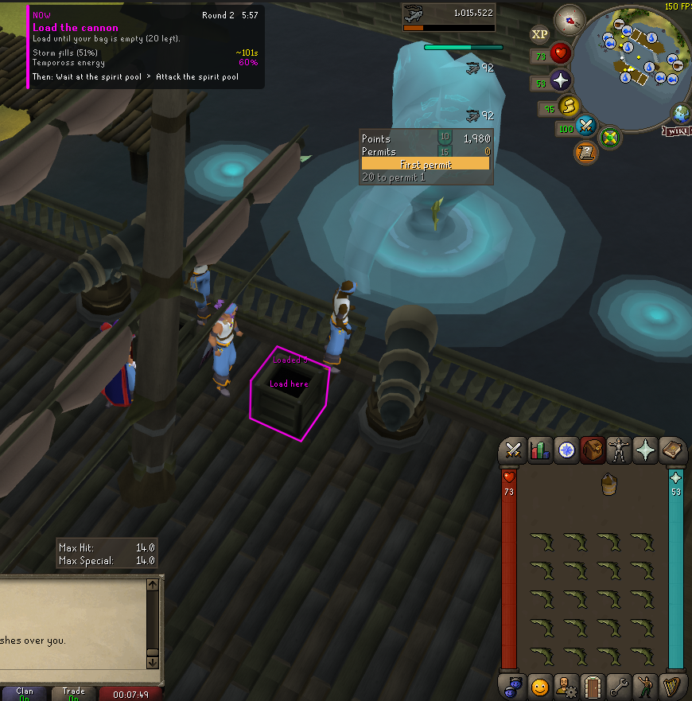
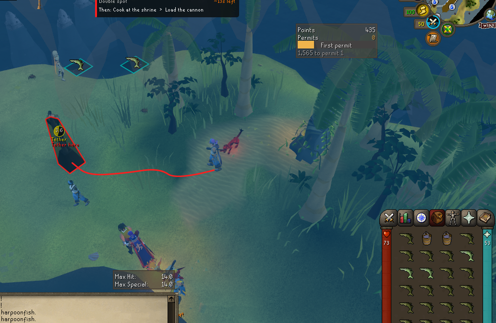
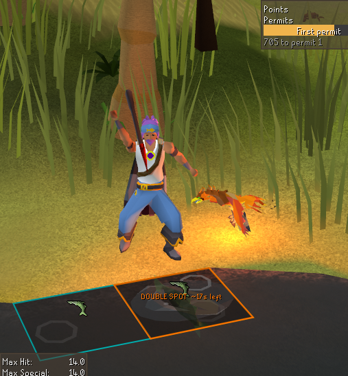
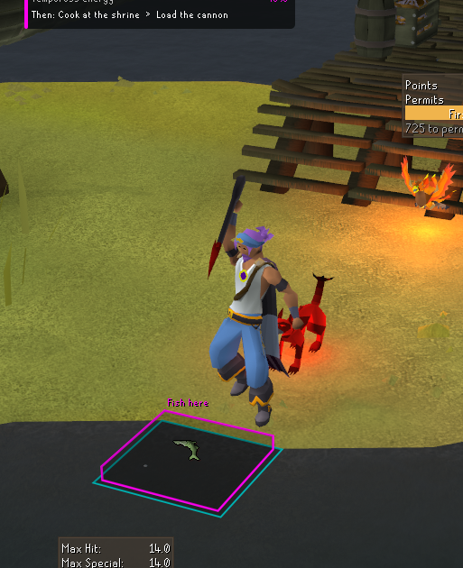
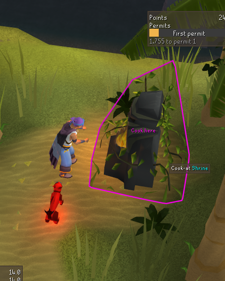
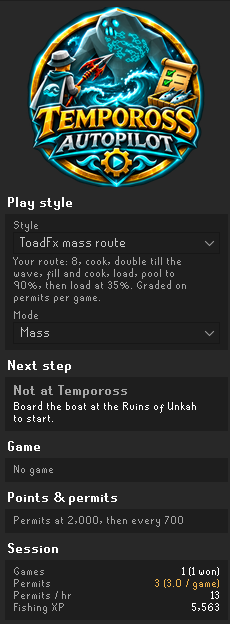
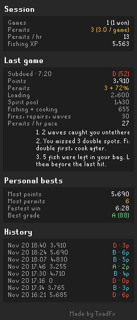

# Tempoross Autopilot

A RuneLite plugin that guides you through Tempoross: what to do next, how close you are to
the next reward permit, how long until the storm wins, and a grade with tips after every game.

Works on mass worlds, solo and duo. Made by ToadFx.

## Screenshots

| | |
|---|---|
|  |  |
| **Load the cannon**: the top box with what to do now, the storm and energy, and the next steps; the crate highlighted with your load count. | **Wave incoming**: the path turns red and leads to the nearest totem, with the wave countdown on it. |
|  |  |
| **Double spot** in orange with roughly how long it has left. | **Fish here**: the spot the next step points at. |
|  |   |
| **Cook here**: the shrine outlined when it's time to cook. | **Side panel**: play style and mode, session, last game's grade and tips, personal bests and history. |

## Play styles

Pick your **mode** first (Mass, Duo or Solo) in the side panel. The style list then only shows the
styles for that mode, with the recommended one first (marked with a star). The next step, the
highlights and your post-game grade all follow the style.

| Style | Modes | What Autopilot does | Graded on |
|---|---|---|---|
| **Recommended mass** (default) | Mass, Duo ★ | Theoatrix's mass run: catch 9 at the nearest spot and cook them, fill up at a double spot, cook it all, load a full bag, fish until he's down, then the spirit pool. Leave right away after the win | permits per game |
| **ToadFx mass route** | Mass | Round 1: catch 8 and cook them, fish the double spot until the wave, then the double (or the nearest spot) until the bag is full, cook it all, load until empty (or 0% energy), spirit pool until Tempoross is back to 90%. Round 2 on: fish and cook a full bag; load it all once it's cooked, or everything at 35% energy if that comes first; wait at the spirit pool until 0%, fish it until he's subdued, then leave | permits per game |
| **Max permits / hr** | Mass, Duo | The wiki cooking method: catch 7 (9 at 85+), cook, start loading at 49% energy, leave right away after the win | permits per hour |
| **Max points / game** | Mass, Duo | Theoatrix's max points: catch about 8 and cook them while you wait for a double spot, fill up there, load a full bag; also douses fires and fixes masts, counting down to your points target | points per game |
| **Max Fishing XP** | Mass, Duo | Theoatrix's XP setup (crystal harpoon, spirit angler outfit, Imcando hammer): double spots first, then the spirit pool; loads raw only when the bag is full | Fishing XP per hour |
| **Firefighter** | Mass, Duo | Puts out every fire and repairs every mast (40 points each); Humidify keeps your buckets full | points per game |
| **Recommended solo** | Solo ★ | The wiki's 17 / 19 / 19 / 27 route: cook, load the exact count each round (it stops you at the number), no spells needed | permits per hour |
| **Solo max permits** | Solo | The wiki's cooking + firefighting route (17 / 19 / 19), putting out fires for points; Humidify helps | permits per game |
| **Solo 5 rounds** | Solo | The wiki's 5-round method (26 / 26 / 28 a round), most points per game | points per game |
| **Solo max Fishing XP** | Solo | The wiki's no-cooking method: 26, then 27 raw a trip | Fishing XP per hour |
| **Chill: one permit** | Any | Gets you to 2,000 points, then tells you you're safe | reaching 2,000 |
| **Custom** | Any | Your own cooking rule and points target | your target |

## Features

- **Top instructions box**: at the top of the screen, what to do **now** (tether, repair, load, cook,
  fish or head to the spirit pool) with the reason and the points it's worth, the game timer and round,
  a **coming up** list (wave hits in, lightning fire lands in, next fire spread, storm
  fills in, Tempoross energy, double spot open) and **then** the next two steps after this one.
- **Points and permits box**: live points, permits earned, points to the next permit and your bonus roll.
  Permits come at 2,000 points, then every 700.
- **Lightning, fire and wave timers**: a countdown pie on each lightning cloud until the fire lands,
  on each fire until it spreads, and on every mast and totem pole until the wave hits (green once
  you're tethered, red on broken ones).
- **Spirit pool**: as soon as energy hits 0 (or is almost gone and you have nothing to load), you're
  sent to the spirit pool, highlighted even before it opens.
- **Storm race**: if you're holding fish and the storm will fill before you can reach the crate,
  Autopilot tells you to load now.
- **Path line**: a walking line from your feet to the next step's target (crate, shrine, fishing spot, spirit pool, mast, fire), like GOTR Coach's, plus the same route on the minimap. Line, tiles or both; width, rounded corners and colour are settings. It turns red when the step is urgent.
- **Highlights**: the next target with a label, double spots with a timer (how long it has been up, then roughly how long it has left once the plugin has seen a few), fires, broken masts and totems, and a
  load counter over the crate.
- **Solo styles** from the OSRS Wiki with exact load counts per round: 17 / 19 / 19 / 27 (recommended),
  cooking + firefighting, 5 rounds and no cooking. Autopilot stops you at the number, because loading
  more makes Tempoross vulnerable too early.
- **Pre-game check**: grabs a harpoon, rope, hammer and buckets, then fills the buckets.
  The full spirit angler's outfit counts as a rope.
- **Gear reminders**: remembers the harpoons and angler / spirit angler pieces you own (from your
  bank, inventory and worn items) and reminds you to bring them: your best harpoon for your play style
  (infernal for points, crystal for Fishing XP, dragon for its +3 special) and the outfit
  (the full set gives +2.5% Fishing XP), plus the Imcando hammer, which waves and fires can't take. You also get one chat reminder when you reach the Ruins of Unkah.
- **Alerts**: wave incoming (when you aren't tethered), double spot, storm warning, load target
  reached, new permit.
- **Post-game report card**: S to D grade for your play style, a points breakdown (loading,
  spirit pool, fishing and cooking, fires and waves) and your top three tips. A summary goes in chat.
- **Side panel**: play style and mode pickers, next step, the live game, session totals
  (permits per hour), last game, personal bests and history (saved per character).

## Settings

| Section | Settings |
|---|---|
| Play style | Play style, points target, Custom cooking rule, barehanded fishing, gear reminders, buckets to carry |
| Mass and solo | Mode (Mass / Duo / Solo), storm danger mark (when to say load now) |
| Overlays | Each box, highlight and timer on or off |
| Path | Line / tiles / both / off, minimap, width, rounded corners, detail, colour |
| Colours | Next step, double spot, fire, timers, urgent |
| Alerts | Each alert on or off, storm warning level |
| Report card | Chat summary, save history, reset history |

## Colours

Defaults: next step magenta `#FF00F1`, double spot orange `#FF7300`, timers yellow `#FFEB00`, urgent red `#FF1E1E`. All can be changed in Colours.

## Credits

Strategy, points and permit numbers come from the
[OSRS Wiki Tempoross pages](https://oldschool.runescape.wiki/w/Tempoross/Strategies). The mass-world run
and the max points and XP setups follow [Theoatrix's Tempoross guide](https://www.theoatrix.net/post/osrs-tempoross-guide-1).
Game IDs come from RuneLite's gameval API. See [NOTICE](NOTICE).

Tempoross Autopilot never clicks or plays for you. It only shows information, highlights and
notifications.
