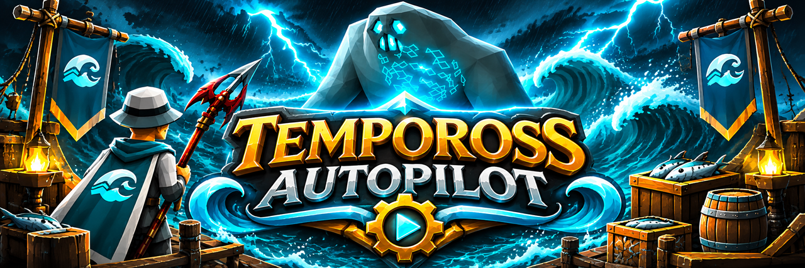

# Tempoross Autopilot

A RuneLite plugin that guides you through Tempoross: what to do next, how close you are to
the next reward permit, how long until the storm wins, and a grade with tips after every game.

Works on mass worlds, solo and duo. Made by ToadFx.

## Play styles

Pick what you're there for, in the side panel or the plugin settings. The next step, the
highlights and your post-game grade all follow it.

| Style | Cooking | What Autopilot does | Graded on |
|---|---|---|---|
| **Max permits / hr** (default) | Yes | Load as soon as you have fish, finish him fast, leave right away | permits per hour |
| **Max points / game** | Always | Cook everything, douse fires, fix masts, counts down to your points target | points per game |
| **Max Fishing XP** | Never | Double spots first, then the spirit pool; loads raw only when the bag is full | Fishing XP per hour |
| **Balanced XP + permits** | In batches | The wiki cooking method: catch 7 (9 at 85+), cook, start loading at 49% energy | XP and permits |
| **Firefighter** | Yes | Puts out every fire and repairs every mast (40 points each) | points per game |
| **Chill: one permit** | No | Gets you to 2,000 points, then tells you you're safe | reaching 2,000 |
| **Custom** | Your choice | Your own cooking rule and points target | your target |

## Features

- **Next step box**: tether, repair, load, cook or fish, with a reason and the points it's worth.
- **Points and permits box**: live points, permits earned, points to the next permit and your bonus roll.
  Permits come at 2,000 points, then every 700.
- **Storm bar**: storm intensity with a danger mark (93% by default, the wiki's last safe trip from
  the shrine), how many seconds until it fills at the current rate, and wave warnings.
- **Storm race**: if you're holding fish and the storm will fill before you can reach the crate,
  Autopilot tells you to load now.
- **Highlights**: the next target with a label, double spots, fires, broken masts and totems, and a
  load counter over the crate.
- **Solo routes** from the OSRS Wiki with exact load counts per round: 17 / 19 / 19 / 27,
  5 rounds, and cooking + firefighting. Autopilot stops you at the number, because loading more
  makes Tempoross vulnerable too early.
- **Pre-game check**: grabs a harpoon, rope, hammer and buckets, then fills the buckets.
  The full spirit angler's outfit counts as a rope.
- **Gear reminders**: remembers the harpoons and angler / spirit angler pieces you own (from your
  bank, inventory and worn items) and reminds you to bring them: your best harpoon for your play style
  (infernal for points, crystal for Fishing XP, dragon for its +3 special) and the outfit
  (the full set gives +2.5% Fishing XP). You also get one chat reminder when you reach the Ruins of Unkah.
- **Alerts**: wave incoming (when you aren't tethered), double spot, storm warning, load target
  reached, new permit.
- **Post-game report card**: S to D grade for your play style, a points breakdown (loading,
  spirit pool, fishing and cooking, fires and waves) and your top three tips. A summary goes in chat.
- **Side panel**: play style and mode pickers, next step, the live game, session totals
  (permits per hour), last game, personal bests and history (saved per character).

## Settings

| Section | Settings |
|---|---|
| Play style | Play style, points target, Custom cooking rule, barehanded fishing, gear reminders, buckets to carry |
| Mass and solo | Mode (Mass / Solo / Duo), solo route, storm danger mark |
| Overlays | Each box and highlight on or off |
| Colours | Target, double spot, fire, urgent |
| Alerts | Each alert on or off, storm warning level |
| Report card | Chat summary, save history, reset history |

## Credits

Strategy, points and permit numbers come from the
[OSRS Wiki Tempoross pages](https://oldschool.runescape.wiki/w/Tempoross/Strategies).
Game IDs come from RuneLite's gameval API. See [NOTICE](NOTICE).

Tempoross Autopilot never clicks or plays for you. It only shows information, highlights and
notifications.
